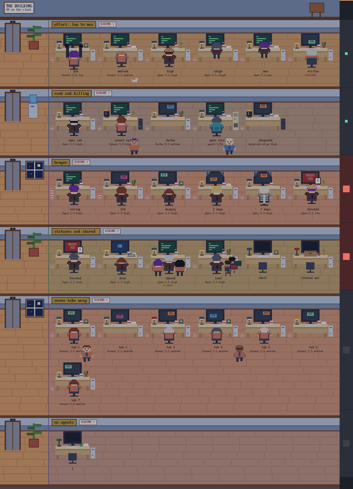

# The Building

A pixel-art building in its own window on a spare vertical monitor, next to the normal Herdr
window, in the key of dark office comedy. Every Herdr space is a floor, every tab is a computer, and
every agent is a person at that computer: you can see who is typing, who needs you and who has
finished, and also who hasn't been fed in a week and is now a skeleton. Past the fence stand the
headstones of every context that ever died. Nothing on screen pretends agents interact when they
don't.

## What you see

One fixed look: no title bar, theme `graphite`. Pixel text is `PxPlus IBM VGA 8x16`. Nothing is
rounded. Desks are Office's at `k = 2.5/3` (a slot is 142×158); people are Office's sprites at a
whole 3px per art pixel. Floors never shrink: when they don't fit, the building scrolls. Left to
right:

1. **The building**, the window less the lights. Top to bottom:
   - **Roof**, 60px: the sign `THE BUILDING` over `N on the clock`, a water tank.
   - **One floor per space**, in `spaces()` order. Height 48 + 158 per row.
     - **Back wall**, 40px, with a brass plate (space name) and a `HIRING +` sign.
     - **Bay**, 146px at the left (84px below 460px wide): the elevator and one piece of furniture
       fixed by a hash of the space: water cooler, bookshelf, window on the real clock, or plant.
     - **Computers**, one per tab in tab order, as many per row as fit (6 at 1054px, 1 at 354px).
       There are no spare desks: computers always equal tabs. A tab with no agent has an empty
       chair and a dark screen. Under each desk: the context's title, or the tab's name when it
       has no title of its own, and below it the model and effort (`Opus 5.5 high`).
     - **Slab**, 8px `#7a4a28`.
   - **Ground**, the rest of the window, at least 70px.
2. **The graveyard**, right of the building past an iron fence. Sky on the real clock, the sign
   `BELOVED CONTEXTS` over `N in the ground`, then headstones in columns of 96×106, newest by the
   fence, growing to the right. A stone says `R.I.P.`, the name, the turns and the last date. It
   gathers moss, one patch per 14 days. `Died on the job` gets a cross.
3. **Floor lights**, 40px, fixed at the right edge, never panned. One segment per floor, in proportion
   to the floor, with a 2px `#e2a465` bracket around what is on screen. blocked: red segment,
   `#e0483c` lamp blinking every 700ms. done: steady `#5ab0e0` lamp. working: small `#5ee08a` dot.
   Otherwise an unlit `#3a3f4a` lamp. At the bottom a `RIP` tile with the number of dead.

**People.** Looks fixed by a hash of the address. Three separate things show:

- **Effort is posture.** low: legs up on the desk, feet past both ears. medium: slumped. high: upright.
  xhigh: standing, while working. max: standing, faster, sweating, while working. Unknown: plain
  sitting. Bob speed runs 950ms, 620, 380, 230, 120.
- **Rank is the outfit**, from a hand-written table, since no API says how good a model is. Opus and
  Fable: dark suit with a white collar and a vent. Sonnet and DeepSeek: shirt and collar. Haiku: tee,
  bare arms. Anything else: hoodie.
- **Vendor is the colour** of the outfit: Claude `#d97757`, qwen `#3f9aa6`, DeepSeek `#4f7dc9`, others
  from a small table.

**Where it runs is the computer.** Local: a big beige tower with blinking lights. API: a dark tower
and a coin meter that ticks while it works. Subscription: Office's light tower.

Up to three people share a computer: the first in the chair, the rest standing beside it. **Interns**
(terminals whose `parent` leads back to an agent) sit on a stool with a laptop in their own status
colour. Four people show at most; then the label adds `+N more`. Anything that reports no model and
isn't Claude Code gets a red `VISITOR` line instead of a guessed rank.

## How it behaves

- **Statuses**, as in Office. working: green code lines, bobbing. blocked: red `NEEDS YOU`, jumping, a
  `?` bubble. done: blue `OK`, head down, `zZz`. idle: bouncing `DVD`. Status always wins over posture.
- **Hunger.** Input drops a ramen cup on the desk; working is eating, with steam. One empty cup goes on
  the pile beside the desk per ten real prompts, six at most. Time since the last real input:
  12 hours, hungry: slumped, stops wandering. 2 days: cobwebs on monitor and chair. 7 days: a skeleton
  in the chair, DVD logo still bouncing. Any input brings them straight back. A blocked skeleton
  still jumps, because the alarm comes first.
- **Ambient life stays on the worker's floor.** Each second a fed idle worker gets up with chance 3.5%
  (done 1.5%), walks the aisle to the bay, stays 3–11s at the furniture and walks back. Work or a block
  sends them back. A new agent steps out of the elevator, whose doors stay open 4s. Nobody arrives on
  startup. The cat roams, changing floor now and then. Night dims the building, 19–6h.
- **Removed from Office:** walking over to another worker to chat, and random thought bubbles.
- **Report bubbles:** an agent's real status report shows for 6s when it changes.
- **Dying.** A context is dead when its transcript has no running process, or when its title starts
  `RIP-`: its desk gets a cardboard box and `cleared out`, and renaming it back undoes that. Herdr's
  `done` is not death, it only means unseen. Cause of death, all from the transcript: `Retired` (a
  `RIP-` title), `Cut off mid-sentence` (ended on an interrupt), `Died on the job` (ended mid tool
  call), `Starvation` (no activity for a week), else `Laid off`.
- **Hover** a desk: yellow note with title, space, model, effort, billing, status, time since fed,
  report. Hover a stone: title, project, model, turns, days on the job, cause, last words.
- **Moving.** Wheel scrolls the building. Shift+wheel, a sideways wheel or dragging the floor pans to
  the graveyard, where the plain wheel pans too. A floor light jumps to that floor; the `RIP` tile
  goes to the graveyard and back. Nothing scrolls on its own.
- **Clicks act on the main window**, through `HERDR_APP_HOME=<main> herdr-app do …`. Person or desk:
  `agent.focus`. Empty desk: `pane.focus`. Intern: `terminal.peek`. `HIRING +`: `tab.new` in that
  space with the first installed agent.
- **Sounds and toasts** stay with the main window.

## Built from

- **Home:** `~/.config/herdr-office-wall`, a second app home on the same herdr-core. The main home is
  untouched. Declared in `modules/home/herdr-layouts.nix`, with the `office-wall` launcher pointed at
  this layout. The old `office-wall` layout stays one `ctrl-shift-l` away.
- `layouts/building.json`: one block, mod `building`, props `{mainHome, python}`.
- `mods/building/art.js` and `fonts/`: Office's, unchanged (MIT, zuccs/herdr-office-layout; the font is
  CC BY-SA 4.0 and keeps its licence file).
- `people.js`: rank, hunger, postures, ramen, towers, cobwebs, headstones.
- `main.js`: one mod. The floors' walls and the graveyard are retained views, rebuilt only when their
  data changes. A 250ms timer advances walks and the mod notifies only on real changes. Scrolling is
  the mod's own offset on a clipped div: `track_scroll` only drives virtual lists, and those would
  drop walkers off screen.
- `facts.py`: runs every 20s, read-only but for its cache at `~/.cache/herdr-building/state.json`. It
  asks `hc get` about every terminal, walks each process in `~/.claude/sessions/<pid>.json` up to its
  terminal, and reads each transcript once and then only from where it stopped. The first scan of
  165 transcripts (1.4 GB) took under 3s.
- `demo.js`, with props `{demo: true}`: one of everything, for review and screenshots.
- **Overrides:** terminal labels `building.model`, `building.effort` and `building.where` beat what the
  transcripts say. That is how a non-Claude agent can report itself.

## Watch out

- `herdr-app check` passes but doesn't catch a bad colour, and `status` shows no errors while the view
  draws an error card: look at a `shot` after every change.
- People must stay on whole pixels: at s = 2.5 the sprite rows gap into stripes.
- Your restore script runs `claude --resume X --fork-session`. The fork has no transcript until its
  first input, so `facts.py` reads `X` from the command line. Without that, every restored agent looks
  freshly hired.
- `status_ms` and `turn` reset on a core restart, so they only count when `turn > 0`.
- One stone per name: resuming leaves older sessions under the same title.
- Hot reload doesn't fire through a symlinked mod folder: `layout.switch` away and back.
- Testing without a real screen: headless sway works, `WLR_BACKENDS=headless` plus a short
  `HERDR_APP_HOME` (the socket path has a length limit). weston has no seat and the app panics.
- Reports are real text and last words quote your sessions: keep live screenshots private.

## Done when

- ✅ `status` shows `building` and no errors; shots look right at 1054×1841, 1054×900 and 354×1861.
- ✅ One floor per space, one computer per tab, no spare desks (9 floors, 22 computers today).
- ✅ Model, effort, billing and last input read correctly for the 19 Claude agents with history.
- ✅ Hover notes on desks and stones.
- ⬜ Wheel, shift+wheel, drag, floor lights and the `RIP` tile with a real pointer.
- ⬜ Clicking a person focuses that agent in the main window, and raises it.
- ⬜ A real `hc run` from an agent seats an intern (demo only so far).
- ⬜ A new agent arriving by elevator, and a real `RIP-` rename.
- ⬜ An agent finishing on the wall's own selected tab still shows `done`.
- ⬜ CPU on the real screen. On a virtual screen: 64% of a core, against Office's 44%.

## Not built yet

- **Message walks:** the elevator ride when one agent really messages another. No terminal has sent
  one yet, and detecting it means reading screens, so this comes last, if at all.
- **Resurrection:** clicking a headstone to run `claude --resume`. Open question.
- **Non-Claude agents:** opencode's plugin stays silent in this app, because its `HERDR_*` variables
  aren't set. Whether it reports some other way needs one real opencode tab. Non-Claude contexts also
  get no headstones yet.
